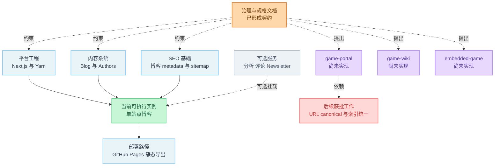

# 当前架构模板基线审计

> **审计日期：** 2026-11-02  
> **审计类型：** 只读架构与模板基线审计  
> **审计对象：** 当前 `main` / `c6cc024d9493d4c60d8fb785346d4cb369c6538b`  
> **对照基线：** Phase 0 / `723499bf9e590b398ed888cffc834a9c54274d00`  
> **限制：** 未修改源代码、依赖、包配置或架构；未安装包；未执行带自动修复或明确生成产物的命令；未进入后续阶段实施。

---

## 1. 结论摘要

### 已验证事实

1. 当前 HEAD 是 Phase 0 基线的后代，当前工作区在审计前后均为干净状态。
2. `723499b..c6cc024` 的变化主体是治理、架构、SEO 与 ballgames 规格文档；应用源代码没有新增 portal、wiki 或 embedded-game 业务实现。应用目录中的差异仅包含生成文件 `app/tag-data.json`，另有 `tsconfig.tsbuildinfo` 变化。
3. 当前可执行架构仍是 Tailwind Nextjs Starter Blog：博客首页、文章、标签、项目、作者页、Newsletter API，以及 Blog/Authors 两种 contentlayer 文档类型。
4. ballgames 的实例配置层、Catalog、Game Detail、页面级 `indexable`、统一 URL helper 与 portal sitemap 过滤仍是 proposed 文档契约，不是已实现能力。
5. 本机无修复版 typecheck 与 lint 通过；当前 HEAD 的 build 与静态导出没有在本轮重跑，因此不能记为本轮 PASS。

### 总体评估

当前仓库适合作为“博客模板 + 已成形的架构/SEO 规格基线”，但尚不能作为已实现的 Game Site Kit 运行时基线。Phase 0 审计仍可用于说明原始模板能力；若用于描述当前仓库，则必须同时阅读本报告与 `docs/agent/STATUS.md`，避免把后续新增的 proposed 规格误认为代码能力。

---

## 2. 范围、方法与证据规则

本轮检查范围：

- Git 基线、提交血缘与工作区状态
- 包管理、运行环境、脚本与 CI
- Next.js 路由、布局与部署模式
- contentlayer 内容管线与生成物
- SEO、canonical、robots、sitemap、JSON-LD 与 RSS
- 站点实例配置、原型能力与 ballgames 契约对齐
- 安全头、iframe 边界与可选服务
- Agent 治理与自动化验证能力

事实来源限定为当前检出文件、Git 只读命令与本轮实际执行命令。生产环境、域名、第三方许可和未执行构建的行为不作推断。

---

## 3. 基线与仓库状态

### 3.1 当前修订

- **文件/命令证据：** `git rev-parse HEAD`、`git describe --tags --always`、`git show -s`。
- **相关值：**
  - HEAD：`c6cc024d9493d4c60d8fb785346d4cb369c6538b`
  - describe：`v2.4.0-15-gc6cc024`
  - 分支：`main`
  - 跟踪：`pcaaron/main`
  - HEAD 时间：`2026-11-02T10:21:38+08:00`
- **观察行为：** `git merge-base --is-ancestor 723499b HEAD` 退出码为 0；审计前后 `git status --porcelain` 无输出。
- **评估：** 当前 HEAD 线性包含 Phase 0 基线，且本轮验证未产生已跟踪文件改动。

### 3.2 Phase 0 后的变化性质

- **文件/命令证据：** `git diff --name-status 723499b..HEAD`、`git diff --stat 723499b..HEAD`。
- **相关引用：**
  - 新增：`specs/**`、`docs/agent/**`、`.cursor/rules/project-workflow.mdc`
  - 应用目录变化：`app/tag-data.json`
  - 构建缓存变化：`tsconfig.tsbuildinfo`
- **观察行为：** 26 个路径发生变化，约 3575 行新增；没有新增或修改 portal 路由、Game 内容模型、实例配置模块或 URL helper。
- **评估：** 当前提交序列推进了文档契约与治理，而非运行时架构。将 Phase 2/2.2 的 “validated” 理解为“代码已实现”是不正确的；`STATUS.md` 已明确标注其为文档验证。

### 3.3 生成文件被版本控制

- **文件证据：**
  - `contentlayer.config.ts:63-92` 的 `createTagCount` / `createSearchIndex`
  - `contentlayer.config.ts:182-186` 的 `onSuccess`
  - `.gitignore:16-29`
  - 已跟踪：`app/tag-data.json`、`tsconfig.tsbuildinfo`
- **观察行为：**
  - contentlayer 成功后会写入 `app/tag-data.json` 与 `public/search.json`。
  - `.gitignore` 忽略 `public/search.json`，但不忽略 `app/tag-data.json` 或 `tsconfig.tsbuildinfo`。
  - 相对 Phase 0，`app/tag-data.json` 新增 `"hello": 1`，`tsconfig.tsbuildinfo` 也发生变化。
- **评估：** 生成物与缓存进入 Git 会造成构建噪声和“文档-only 提交含生成差异”的风险。是否继续跟踪 `app/tag-data.json` 属于架构决策；`tsconfig.tsbuildinfo` 更接近可再生缓存。

---

## 4. 当前可执行架构

### 4.1 运行时仍是博客模板

- **文件证据：**
  - `app/Main.tsx:8-89`
  - `data/headerNavLinks.ts:1-9`
  - `app/blog/[...slug]/page.tsx:24-120`
  - `app/api/newsletter/route.ts:1-11`
- **观察行为：**
  - 首页展示最新 5 篇文章，并按配置渲染 Newsletter 表单。
  - 主导航是 Home、Blog、Tags、Projects、About。
  - 文章详情由 contentlayer 生成静态参数并渲染 BlogPosting JSON-LD。
  - Newsletter API 仍存在。
- **评估：** `game-portal`、`game-wiki` 与 `embedded-game` 均未形成运行时页面或适配器；当前生产形态仍是上游博客信息架构。

### 4.2 Content System 只有 Blog 与 Authors

- **文件证据：**
  - `contentlayer.config.ts:96-148`
  - `contentlayer.config.ts:150-186`
- **观察行为：**
  - `Blog` 匹配 `data/blog/**/*.mdx`。
  - `Authors` 匹配 `data/authors/**/*.mdx`。
  - `documentTypes` 仅为 `[Blog, Authors]`。
- **评估：** MDX/contentlayer 管线是已验证的可复用基础设施；Game、Category、WikiEntry、GameRuntime、Catalog adapter 均不存在。`specs/04-config-and-content-models.md` 的模型目前只是逻辑契约。

### 4.3 无站点实例配置层

- **文件证据：**
  - `data/siteMetadata.js:1-100`
  - `specs/04-config-and-content-models.md:31-40`
- **观察行为：**
  - 运行时只有单个模板 `siteMetadata` 对象。
  - proposed 的 `siteId`、`archetype`、`canonicalOrigin`、`urlPathStyle`、`defaultIndexable`、`enabledPageTypes`、`featureFlags` 没有代码载体。
- **评估：** 当前不能证明品牌、canonical、launchUrl 与 feature flags 已按实例隔离。多实例能力应继续标为 proposed。

---

## 5. 包管理、环境、脚本与 CI

### 5.1 已核实版本

- **文件/命令证据：**
  - `package.json:1-79`
  - `.yarnrc.yml:1-3`
  - `.devcontainer/devcontainer.json:1-20`
  - `.github/workflows/pages.yml:20-41`
  - `node --version`
  - `yarn --version`
- **观察行为：**
  - Next.js `15.5.12`
  - React / React DOM `19.2.4`
  - Tailwind CSS `4.1.18`
  - contentlayer2 / next-contentlayer2 `0.5.8`
  - TypeScript `5.9.3`
  - Yarn `3.6.1`，`nodeLinker: node-modules`
  - Dev Container 与 GitHub Pages 使用 Node 20
  - 本轮本机 Node `v22.14.0`
  - `package.json` 没有 `engines`
- **评估：** CI/容器基准是 Node 20，本机检查使用 Node 22；缺少 `engines` 使本地兼容范围没有包级约束。本轮不能据此断言所有 Node 20/22 组合等价。

### 5.2 `start` / `serve` 语义与既有审计不一致

- **文件证据：**
  - `package.json:5-13`
  - `scripts/next-with-init-cwd.mjs:11-31`
  - `docs/agent/reports/template-audit.md:49-58`
- **观察行为：**
  - 当前 `start` 实际为 `next dev`。
  - 当前 `serve` 实际为 `next start`。
  - Windows wrapper 支持 `dev|build|start`，但 `start` 与 `serve` 都未使用该 wrapper。
  - 既有审计把 `start` 记录为 `next start`。
- **评估：** 这是已验证的脚本语义与文档漂移。它不影响本轮 typecheck/lint，但会误导运行手册、部署命令和 Windows 行为判断。

### 5.3 CI 只执行导出构建

- **文件证据：** `.github/workflows/pages.yml:18-55`。
- **观察行为：**
  - CI 安装依赖后执行 `yarn build`。
  - 构建环境设置 `EXPORT=1`、`UNOPTIMIZED=1` 与 Pages `BASE_PATH`。
  - workflow 未单独执行 `yarn typecheck` 或 lint。
- **评估：** build 可能间接捕获部分类型问题，但当前 CI 没有独立的 lint/typecheck 质量门。静态导出是现有部署主路径，而不是附带场景。

### 5.4 验证脚本存在副作用边界

- **文件证据：**
  - `package.json:5-13`
  - `contentlayer.config.ts:63-92,182-186`
  - `scripts/postbuild.mjs:1-7`
  - `scripts/rss.mjs:40-64`
- **观察行为：**
  - `yarn lint` 自带 `--fix`，不是纯审计命令。
  - `yarn typecheck` 使用启用了 incremental/composite 的 `tsconfig.json`，可能更新已跟踪的 `tsconfig.tsbuildinfo`。
  - `yarn build` 会经过 contentlayer `onSuccess`，随后生成 RSS，并写入 `.next`/`.contentlayer`、`app/tag-data.json`、搜索索引和 RSS/export 产物。
- **评估：** 审计模式下不应把原脚本都视为无副作用检查。本轮采用 CLI 参数关闭写入或移除 `--fix`，并未执行 build。

---

## 6. SEO 与 URL 基线

### 6.1 生产 URL 仍指向上游演示站

- **文件证据：**
  - `data/siteMetadata.js:2-12`
  - `app/layout.tsx:21-41`
  - `app/sitemap.ts:7-20`
  - `app/robots.ts:6-14`
- **观察行为：**
  - `siteUrl` 是 `https://tailwind-nextjs-starter-blog.vercel.app`。
  - metadataBase、RSS alternate、sitemap、robots host/sitemap 都消费该值。
- **评估：** 若按当前配置构建 ballgames，canonical/OG/sitemap/robots 会指向错误站点。该项是上线阻塞，不代表开发环境当前构建失败。

### 6.2 URL 生成分散，尚未满足单一 helper 契约

- **文件证据：**
  - `app/layout.tsx:21-41`
  - `app/seo.tsx:11-32`
  - `app/sitemap.ts:7-20`
  - `contentlayer.config.ts:113-126`
  - `scripts/rss.mjs:10-37`
  - `specs/04-config-and-content-models.md:211-215`
- **观察行为：**
  - canonical/OG 使用相对 `'./'`。
  - sitemap、JSON-LD 与 RSS 分别用字符串拼接生成绝对 URL。
  - proposed 的 `siteUrl(path?)` / `gameUrl(slug)` 不存在。
- **评估：** 当前博客功能可工作，但无法保证 canonical、OG、JSON-LD、sitemap、RSS 与未来内链同源同格式；这正是 Phase 3 文档列出的实现缺口。

### 6.3 trailing slash 与 ballgames 契约冲突

- **文件证据：**
  - `next.config.js:65-71`
  - `specs/seo/02-url-canonical-indexing.md:11-27`
  - `specs/phases/02-seo-page-model-and-content-contract.md:41-50`
- **观察行为：**
  - Next 配置为 `trailingSlash: true`。
  - ballgames 契约要求根与 path canonical 均无尾斜杠。
  - Phase 2.2 已把该冲突记录为 Phase 3 技术风险。
- **评估：** 文档与实现现状一致地承认了冲突，但尚未解决。在 portal URL 上线前必须统一 redirect、canonical、sitemap 与 JSON-LD 的路径格式。

### 6.4 `canonicalUrl` 字段存在但未被文章 metadata 消费

- **文件证据：**
  - `contentlayer.config.ts:100-112`
  - `app/blog/[...slug]/page.tsx:24-74`
- **观察行为：**
  - Blog schema 声明了 `canonicalUrl`。
  - `generateMetadata` 没有读取该字段，也没有返回 `alternates.canonical`。
- **评估：** frontmatter 中填写该字段不会改变文章 canonical。既有 Phase 0 审计对此判断仍准确。

### 6.5 sitemap 仍是博客规则，且静态路由 lastmod 每次构建变化

- **文件证据：**
  - `app/sitemap.ts:7-22`
  - `specs/seo/04-internal-linking-sitemap.md:45-73,83-85`
- **观察行为：**
  - sitemap 包含根、blog、projects、tags 与所有非 draft Blog。
  - 静态路由 `lastModified` 取构建当天日期。
  - 没有 `publicationStatus + seo.indexable + canonical` 的 SitemapCandidate 过滤。
- **评估：** 当前实现不满足 ballgames R1 “恰好 2 个 URL”的契约；静态路由每次构建刷新 lastmod 也不代表真实内容变更。

### 6.6 结构化数据仍是 BlogPosting

- **文件证据：**
  - `contentlayer.config.ts:113-127`
  - `app/blog/[...slug]/page.tsx:99-116`
  - `specs/seo/03-metadata-structured-data.md:38-60`
- **观察行为：**
  - 仅生成并注入 BlogPosting。
  - WebSite、Organization、ItemList、FAQPage、VideoGame 等 portal 结构化数据未实现。
- **评估：** 结构化数据机制可复用，但 ballgames 页面类型映射仍是 proposed。

---

## 7. 安全、静态导出与可选服务

### 7.1 安全头在静态导出路径上没有仓库内落地点

- **文件证据：**
  - `next.config.js:7-56,61-96`
  - `.github/workflows/pages.yml:36-43`
- **观察行为：**
  - Next `headers()` 定义 CSP、X-Frame-Options、HSTS 等响应头。
  - 主部署 workflow 使用 `output: export` 并上传静态 `out`。
  - 仓库中未发现 GitHub Pages/边缘层的独立响应头配置。
- **评估：** 静态文件本身不能携带这些 HTTP 响应头；本轮没有外部部署响应证据，因此不能声称 GitHub Pages 生产响应已应用 `securityHeaders`。

### 7.2 iframe 默认边界不允许第三方游戏

- **文件证据：**
  - `next.config.js:7-18`
  - `next.config.js:30-35`
  - `specs/04-config-and-content-models.md:152-177`
- **观察行为：**
  - CSP `frame-src` 仅允许 `giscus.app`。
  - `X-Frame-Options: DENY` 阻止本站被其他页面嵌入；它不等价于控制本站可嵌入哪些第三方。
  - 第三方游戏是否可在本站 iframe 中加载主要受 `frame-src`、对方响应策略与许可共同约束。
- **评估：** 当前默认策略与“未核实许可不 iframe”一致。任何 embedded-game 或首页 launcher iframe 都需要许可记录及部署层 CSP 决策。

### 7.3 可选服务不是代码层强制关闭

- **文件证据：**
  - `data/siteMetadata.js:27-99`
  - `app/layout.tsx:96-106`
  - `app/Main.tsx:82-88`
- **观察行为：**
  - Analytics 配置对象存在，RootLayout 始终挂载 `Analytics`。
  - Newsletter provider 为 `buttondown`，首页会显示 NewsletterForm。
  - Comments provider 为 `giscus`。
- **评估：** “广告与分析默认关闭”目前主要是治理约束，不是统一 feature flag。未配置 env 时是否发出有效分析/评论请求取决于 pliny 和部署环境，本轮未作外部运行验证。

---

## 8. 类型、测试与维护性

### 8.1 TypeScript 严格度有限

- **文件证据：** `tsconfig.json:2-31`。
- **观察行为：** `strict: false`，但 `strictNullChecks: true`；同时开启 `skipLibCheck`。
- **评估：** 当前 typecheck 通过不等于完整 strict 模式保障。新增跨实例配置和内容模型时，需要显式 schema/运行时校验，不能仅依赖 TypeScript。

### 8.2 没有 test 脚本

- **文件证据：** `package.json:5-13`。
- **观察行为：** scripts 中不存在 `test`、e2e 或 schema validation 命令。
- **评估：** 当前回归门主要是 lint、typecheck、build 与人工审查；URL/canonical/indexable/sitemap 一致性尚无自动化测试证据。

### 8.3 lint 迁移债务已出现

- **文件/命令证据：**
  - `package.json:10`
  - 本轮 `yarn next lint ...` 输出
- **观察行为：** Next.js 明确提示 `next lint` 将在 Next.js 16 移除。
- **评估：** 当前 Next 15.5.12 下仍通过，不是即时故障；在任何 Next 主版本升级前需要迁移到 ESLint CLI。该建议不授权本轮升级或改脚本。

---

## 9. 本轮验证结果

### PASS

1. `git merge-base --is-ancestor 723499bf9e590b398ed888cffc834a9c54274d00 HEAD`
   - 退出码 0。
2. `yarn typecheck --incremental false --composite false`
   - 退出码 0，无错误输出。
   - 说明：这是为避免更新已跟踪 `tsconfig.tsbuildinfo` 而采用的无写入变体，不等同于原样执行 `yarn typecheck`。
3. `yarn next lint --dir pages --dir app --dir components --dir lib --dir layouts --dir scripts`
   - 退出码 0，`No ESLint warnings or errors`。
   - 说明：移除了 `package.json` 脚本中的 `--fix`，因此是审计安全变体。
4. 验证后 `git status --porcelain`
   - 无输出，工作区保持干净。

### NOT RUN

1. `yarn lint`
   - 原因：脚本包含 `--fix`，与 Audit Only 冲突。
2. `yarn build`
   - 原因：明确生成 `.next`、`.contentlayer`、tag/search/RSS/export 产物，并可能更新已跟踪生成文件。
3. `EXPORT=1 UNOPTIMIZED=1 ... yarn build`
   - 原因同上；本轮没有当前 HEAD 的静态导出结果。
4. `yarn test`
   - 原因：脚本不存在。

### 历史证据，不计作本轮 PASS

`docs/agent/STATUS.md:46-52` 与 `docs/agent/reports/template-audit.md:224-237` 记录了 2026-10-30/31 的 lint、typecheck、build 通过结果。由于当前 HEAD 与当时基线不同，且本轮没有重跑 build，这些结果只能作为历史证据。

---

## 10. 发现分级

### P0 — 上线阻塞

1. `data/siteMetadata.js` 仍使用模板域名，不能直接发布为 ballgames。
2. ballgames 无尾斜杠 canonical 与 `trailingSlash: true` 尚未统一。
3. 没有页面级 `indexable` 与 sitemap 资格过滤，不能满足 R1 两 URL 契约。
4. iframe 上线仍缺生产 CSP 证据与逐游戏许可核验。

### P1 — 架构与质量门

1. 站点实例配置层、统一 URL helper、Catalog/Detail 分层仍未实现。
2. CI 未显式运行 lint/typecheck。
3. 当前静态导出部署无法由仓库证据证明安全响应头生效。
4. `start` 脚本实际启动开发服务器，且既有审计记录错误。
5. 生成物/缓存跟踪策略会制造提交漂移。

### P2 — 维护风险

1. `next lint` 已弃用并将在 Next 16 移除。
2. `strict: false` 与无测试脚本降低重构保障。
3. Newsletter/Comments/Analytics 缺统一实例 feature flag 强制边界。

---

## 11. 假设、未知项与建议

### 本报告未依赖的假设

- 没有假设 ballgames.io 已完成域名或 HTTPS 验证。
- 没有假设第三方游戏允许 iframe 或商业使用。
- 没有假设部署环境已配置 Analytics、Giscus、Newsletter 密钥。
- 没有把文档中的 proposed 类型、helper 或路由当成现有代码。

### 未知项

1. 当前生产或预发环境是否存在仓库外的 CDN/边缘安全头配置。
2. ballgames.io 的 DNS、TLS、canonical ownership 与最终部署平台状态。
3. 第三方游戏 launch URL 的可访问性、嵌入许可和对方 CSP/X-Frame-Options。
4. 当前 HEAD 在 Node 20 GitHub Pages 环境中的完整静态导出结果。
5. 未配置/已配置 env 时 pliny 各 provider 的实际网络行为。

### 建议，不构成本轮实施授权

1. 后续获批时，以 Phase 3 单独任务统一实例 `canonicalOrigin`、URL helper、canonical、robots 与 sitemap 资格。
2. 在任何 portal 页面实施前，明确 `trailingSlash` 迁移/共存策略并记录 ADR 或迁移表。
3. 将审计安全的只读 lint/typecheck 与会写入的 format/fix/build 命令区分。
4. 校正 `start`/`serve` 语义及既有模板审计中的脚本记录。
5. 决定 `app/tag-data.json` 与 `tsconfig.tsbuildinfo` 的版本控制策略。
6. 在 CI 中把 lint、typecheck、build 作为可独立定位失败原因的门禁；新增依赖或测试框架须另行批准。

---

## 12. 审计结论

当前 HEAD 的“架构进展”主要体现在明确的规格、状态分层和 ballgames 契约，而不是应用代码。实际模板基线仍是单站点博客，MDX/contentlayer 与博客 SEO 机制可复用；Game Site Kit 的实例隔离、portal 内容模型、统一 URL 与索引机制仍待后续获批阶段实现。

本报告没有修改 `docs/agent/STATUS.md`、`docs/agent/WORKLOG.md`、既有模板审计或任何应用文件，也没有宣布任何后续阶段完成。

---

## 架构图解

