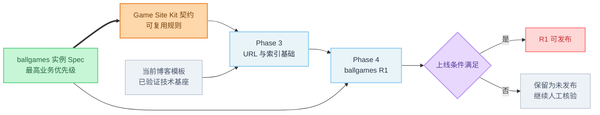
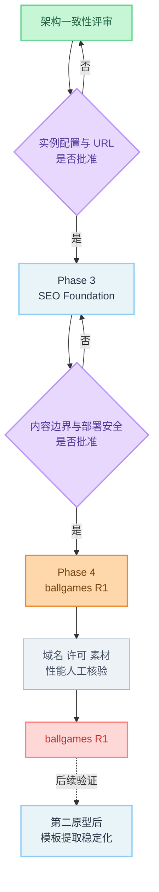

# Architecture Consistency Review

> **评审日期：** 2026-11-02
> **评审状态：** Completed（2026-11-02）；ADR 0003 DEC-003-A–E **Accepted**（2026-11-02）；应用实现 **未开始**
> **原始评审基线：** `main` / `c6cc024d9493d4c60d8fb785346d4cb369c6538b`
> **首次 remediation 基线：** `spec` / `aca82e6b0c8c8467295fba274777ac6b043948e1`
> **Phase 3 readiness remediation 基线：** `spec` / `aa8e1db5c1fd670b9ad0db7d5a4990f754891a51`
> **ADR 0003 决策落地审查 HEAD：** `spec` / `04a61a5bab09bdb7977dc67c56b581f90cb59c3d`（2026-11-02；DEC-003-A–E 用户已批准）
> **业务权威：** `specs/ballgames/ballgames-specs-v1.md`
> **实施状态：** 未修改应用代码、依赖、业务 Spec 或部署配置；未开始后续 Phase

## 1. Executive Summary

### 1.1 最终判断

1. **通用架构能否支持 ballgames.io：有条件支持。**
   Kit 已覆盖 `game-portal`、Catalog / Detail / Indexable 分层、Launcher、页面级 SEO、统一 URL、SitemapCandidate、Structured Data 和实例配置等核心概念；这些均是 **Spec Requirement / proposed contract**，不是当前代码能力。
2. **当前模板能否承载目标架构：可以增量承载，不需要替换 Starter。**
   Next.js App Router、SSG、contentlayer2、Metadata API、sitemap/robots 路由与静态导出机制可复用；博客 IA、Blog/Authors schema 和分散 URL 拼接不能直接充当 portal 业务模型。
3. **是否存在阻止进入后续实现的架构问题：存在条件性阻塞（决策层已关闭 DEC-003，代码层未实现）。**
   当前仓库的正式下一阶段是 **Phase 3 — 最小 SEO Foundation**，不是“Phase 1 — Shared Core”。DEC-003-A–D 已批准，DEC-003-E 只读调查已完成；**无尾斜杠公开 URL 的最终配置/部署方案仍未批准**。进入 Phase 4 前还应确认内容存储边界与 iframe/部署安全边界。
4. **Phase 3 Readiness：Specified / Implementation Gated / Not Started。**
   独立 Phase 3 Spec 已存在；ADR 0003 已 **Accepted**；架构入口决策（DEC-003-A–E）已记录，**Phase 3 应用代码尚未开始**。
5. **Shared Core Readiness：Not Ready / Not an approved phase。**
   仓库现有 Phase 1 已完成且名称为“Agent 文档与工作流基础”；不得重命名或借用该编号。共享模块提取须等待至少两个差异实例验证。

### 1.2 关键阻塞

**P0 — 阻止 ballgames R1 按 Spec 上线**

- 当前 `siteUrl` 仍是模板演示域名，且 `next.config.js` 使用 `trailingSlash: true`，与 ballgames 无尾斜杠 canonical 冲突。
- sitemap 仍输出博客、项目、标签和文章，缺少 `publicationStatus + seo.indexable + canonical` 过滤，无法满足 R1 恰好 2 条 URL。
- ADR 0003 DEC-003-B 已批准 `publicationStatus` 标准术语；PortalHomeContent 契约已 **Accepted**，尚未集成到通用内容模型或应用实现。
- R1 iframe 依赖仍未核实的 embed 许可，当前 `frame-src` 只允许 `giscus.app`，静态导出路径也没有仓库内可验证的响应头落点。
- Portal 页面、Catalog、Game Detail、Launcher 和 portal Structured Data 尚未实现。

**P1 — 进入对应开发阶段前必须解决**

- `/car-soccer` 在实例 Spec 中属于 R3 Category，而 Kit 页面策略表把它定义为 `game_detail`。
- ballgames §2 使用 `status` 简写；Kit 与 DEC-003-B 统一 **`publicationStatus`**（产品 Spec 未改；见 §6.2）。Catalog 与 Detail 发布态分离仍待 ADR 0002。
- DEC-003-A 已批准 Phase 3 最小 SiteInstance；**代码未实现**。
- Contentlayer `Game`、结构化 Catalog 或混合存储尚未选定，Catalog 读取接口也未定义。
- `Organization` / `VideoGame` 所需的可验证字段来源未进入逻辑模型。
- Legacy Car Soccer 文档未标记 superseded，可能把 Agent 引向与当前章程相反的首站和阶段路线。

**P2 — 可后续优化**

- Phase 3 已有独立 Spec：`specs/phases/03-minimum-seo-foundation.md`；Phase 4 尚无独立 Phase Spec，当前仅由路线文档、实例 Spec 和相关 ADR 描述，须在开始 Phase 4 前补齐。
- 品牌扩展、导航、素材、组织信息和 feature flags 只在 Phase 4 或后续实例出现经验证消费者时增量评估；不是 Phase 3 blocker，也不得提前推入最小契约。
- `next lint` 弃用、`strict: false`、无 test 脚本、生成文件跟踪等维护债务。
- WikiEntry 与第三原型的完整 schema 应在对应原型验证时补充，不应为 ballgames R1 提前实现。

## 2. Review Scope

### 2.1 本次范围

- Template Baseline：当前 Tailwind Nextjs Starter Blog 实现与最新只读审计。
- Game Site Kit：章程、逻辑架构、页面类型、配置/内容模型、SEO 契约、Phase Spec、ADR 与长期路线。
- ballgames.io：R1/R2/R3 页面、内容、Launcher、SEO、Sitemap、Structured Data、静态部署和 DoD。
- 三方一致性、模板兼容性、架构 Gap、技术决策、实施顺序和 Phase readiness。

### 2.2 范围外

- 不修改应用代码、依赖、部署配置或业务 Spec。
- 不实现 Shared Core、Catalog、Game Detail、URL helper 或 iframe。
- 不确认生产域名、第三方 URL、许可、素材权利或部署平台能力。
- 不把 Proposed 推荐写成 Accepted。

## 3. Reviewed Sources

### 3.1 治理与状态

- `AGENTS.md`
- `.cursor/rules/project-workflow.mdc`
- `specs/00-project-charter.md`
- `docs/agent/STATUS.md`
- `docs/agent/WORKLOG.md`
- `docs/agent/decisions/0001-template-baseline.md`

### 3.2 模板审计与仓库事实

- `docs/agent/reports/template-audit.md`
- `docs/agent/reports/current-architecture-template-baseline-audit.md`
- Template Audit 会话记录 `0ca109c7-0936-4213-b7bc-089539f95425`
- `package.json`、`next.config.js`、`contentlayer.config.ts`
- `app/**`、`components/**`、`data/**`、`scripts/**`
- `.github/workflows/pages.yml`

### 3.3 Kit 架构与阶段 Spec

- `specs/architecture/01-system-overview.md`
- `specs/01-site-archetypes.md`
- `specs/04-config-and-content-models.md`
- `specs/seo/01`–`05`
- `specs/phases/00`–`03`
- `docs/game-site-kit-seo-architecture-and-template-iteration-guide.md`

### 3.4 ballgames 实例

- `specs/instances/ballgames/README.md`
- `specs/ballgames/ballgames-specs-v1.md`

### 3.5 Legacy / 非现行权威资料

- `docs/game-site-kit-build-guide.md`
- `docs/game-site-kit-agent-ready-spec.md`
- `docs/audit/phase-1-template-audit.md`

这些文件仍以 Car Soccer 单游戏站为首站且没有 superseded 标记。依当前 `AGENTS.md`、章程、STATUS 和 ballgames Spec，它们只能作为历史材料，不能覆盖现行权威。

## 4. Evidence Model

| 标签 | 含义 |
|---|---|
| **Verified Fact** | 可由当前仓库文件、配置或只读 Git 命令直接确认 |
| **Spec Requirement** | 权威 Spec 明确要求 |
| **Conflict** | 两个来源对同一行为给出无法同时成立的要求 |
| **Gap** | 需求已存在，但架构契约或实现缺少对应能力 |
| **Recommendation** | 基于事实的建议，尚未被接受 |
| **Open Question** | 当前资料不足，必须由用户、法务、运营或部署验证决定 |

本报告不把“模板尚未实现”自动判为“不兼容”；只有基础模型或运行约束无法承载目标时才使用 `Incompatible`。

## 5. Current Architecture Baseline

### 5.1 Git 与版本

**Verified Fact**

- 原始 Architecture Consistency Review 基于 `main` / `c6cc024d9493d4c60d8fb785346d4cb369c6538b`。
- 首次 remediation 实际检出分支为 `spec`，HEAD 为 `aca82e6b0c8c8467295fba274777ac6b043948e1`。
- 本次 Phase 3 readiness remediation 实际检出分支为 `spec`，HEAD 为 `aa8e1db5c1fd670b9ad0db7d5a4990f754891a51`，工作区在编辑前干净。
- `spec` HEAD 是 Phase 0 基线 `723499bf9e590b398ed888cffc834a9c54274d00` 的后代。
- `.github/workflows/pages.yml` 仍以 `main` 作为 Pages 部署触发分支；这说明 `main` 是当前部署约定，不等于本次实际检出的 review branch。
- 技术栈：Next.js 15.5.12、React 19.2.4、Tailwind 4.1.18、contentlayer2 0.5.8、Yarn 3.6.1。

### 5.2 当前可执行产品

**Verified Fact**

- `/` 仍渲染最新博客文章：`app/page.tsx`、`app/Main.tsx`。
- 路由仍包含 `/blog`、`/tags`、`/projects`、`/about` 和 Newsletter Route Handler。
- `data/headerNavLinks.ts` 仍暴露博客导航。
- contentlayer 只有 `Blog` 与 `Authors`：`contentlayer.config.ts`。
- 没有 `Game`、Catalog adapter、SiteInstance、URL helper、Launcher 或 `/hockey-bros` 路由。

### 5.3 当前 SEO 与 URL

**Verified Fact**

- `data/siteMetadata.js` 的 `siteUrl` 为模板演示域名。
- `app/layout.tsx` 使用 `metadataBase` 和相对 `./` canonical。
- `app/sitemap.ts` 输出首页、blog、projects、tags 和非 draft 文章。
- `contentlayer.config.ts` 只生成 `BlogPosting` JSON-LD。
- `next.config.js` 设置 `trailingSlash: true`。
- URL 分别在 layout、sitemap、contentlayer 和 RSS 中拼接，没有单一 helper。

### 5.4 静态导出与安全

**Verified Fact**

- `.github/workflows/pages.yml` 通过 `EXPORT=1` 构建 `out` 并部署 GitHub Pages。
- `next.config.js` 的 `headers()` 定义 CSP 等响应头；静态文件自身不能携带这些 HTTP 响应头，仓库内没有 Pages/边缘响应头配置。
- CSP `frame-src` 当前只允许 `giscus.app`。
- `X-Frame-Options: DENY` 用于阻止本站被其他站点嵌入，不负责允许本站加载第三方 iframe。
- Next.js 15 官方静态导出文档确认：预生成动态路由可用 `generateStaticParams`；export 模式没有运行时服务器，Route Handler 仅能输出构建期静态 GET 结果，POST 依赖不能作为静态站运行时能力。

## 6. Requirement Normalization

| 规范术语 | 统一含义 | 不等价概念 |
|---|---|---|
| `CatalogItem` | 首页网格、Launcher、Related 所需最小游戏记录 | 不等于详情页或可索引页 |
| `GameDetailContent` | 某 slug 的详情正文、PageSEO 与扩展内容 | 不等于 Catalog 发布 |
| `IndexablePage` | 已发布、显式 indexable 且通过门槛的页面 | 不等于可玩游戏 |
| `publicationStatus` | `draft / published / archived` | ballgames 中的裸 `status` 应规范化 |
| `availability` | 游戏源可用性 | 不等于页面发布态 |
| `PageSEO` | 页面 metadata、canonical、indexable、更新时间 | 不属于 Catalog 行 |
| `SitemapCandidate` | 通过页面类型、发布、索引和 canonical 规则的 URL | 不等于所有可渲染路由 |
| `LaunchConfig` | iframe、外链或 hosted 的运行配置 | 不等于 EmbedPermission |
| `EmbedPermission` | 可追溯的授权状态与证据 | `unknown` 不等于 `granted` |
| `Phase` | Kit 工程阶段 | 不等于 ballgames R1/R2/R3 Release |

### 6.1 PortalHome publication eligibility

**Accepted Contract / Implementation Not Started**

通用 `SitemapCandidate` 要求页面类型启用、`publicationStatus === "published"`、`seo.indexable === true` 且 canonical 有效。ADR 0003 DEC-003-B（Option B-1）已批准独立 `PortalHomeContent`；`specs/04-config-and-content-models.md` 尚未集成该 publication contract；**应用未实现**。

| Layer | Actual state |
|---|---|
| `specs/04-config-and-content-models.md` | PortalHome publication contract 尚未集成 |
| ADR 0003 | **Accepted** — `PortalHomeContent` contract（DEC-003-B / B-1） |
| Phase 3 Spec | 接口、PageSEO 映射与 eligibility 行为已指定 |
| User approval | **Approved** 2026-11-02 |
| Application | **Not implemented** |

评估的来源方案：

1. **SiteInstance 内嵌 PortalHome 状态**：字段少，但会把站点身份配置、editorial 生命周期和页面更新时间耦合。
2. **独立 PortalHomeContent（推荐）**：页面发布、SEO、正文和更新时间同属一个页面内容对象，可独立 draft/publish/archive。
3. **由 Catalog 推导首页**：无法表达首页独立正文、FAQ、PageSEO 与发布审核，不适合 ballgames。

**Accepted 最小逻辑契约（DEC-003-B / B-1）：**

```typescript
interface PortalHomeContent {
  publicationStatus: 'draft' | 'published' | 'archived'
  seo: {
    title: string
    description: string
    indexable: boolean
    ogImage?: string
  }
  updatedAt?: string
}
```

`PortalHomeContent` 应是首页发布态和 page-level SEO 的单一来源。SiteInstance 仅提供站点级默认 title/description、language/locale、可选默认 social image、`portal_home` 启用状态和 URL 规则。PortalHome 的 title/description 是必填页面字段，缺失时必须校验失败，不得以 SiteInstance 值静默补齐；只有缺失可选 `ogImage` 时才回退站点 `socialBanner`。

canonical 不存入 PortalHomeContent，由 `siteUrl()` 生成；这与共享 PageSEO 中“canonical 缺省由 helper 自指向”的规则一致，并避免第二个 URL 事实源。首页只有同时满足以下条件才可进入 R1 sitemap：

```text
portal_home 已启用
AND PortalHomeContent.publicationStatus 为 published
AND PortalHomeContent.seo.indexable 为 true
AND siteUrl() 等于首页 canonical
```

`PortalHomeContent.updatedAt` 保持为根级内容生命周期字段，并映射为 `ResolvedPageSEO.updatedAt`；不得在 `seo` 下重复存储，也不得在缺失时使用当前构建时间或其他虚构时间。Phase 3 可以定义并验证该契约；实际首页正文对象及页面集成属于 Phase 4。

### 6.2 Publication terminology

**Accepted mapping（DEC-003-B / Option B-1，2026-11-02）**

统一使用 `publicationStatus`，因为 Kit 模型、Catalog Item 与 ballgames §3.1 的 `Game` 示例均已采用该名称。`status` 仍可表示页面策略表的工作流状态或 EmbedPermission 状态，不能作为内容发布态的模糊别名。

待授权对齐位置：

- `specs/ballgames/ballgames-specs-v1.md` §2 规则 1：`status === "published"`。
- 同文件 §4.1 Sitemap 描述：`published && indexable`。
- 同文件 §3.1 与 `Game` 示例：已经使用 `publicationStatus`，无需改变语义。
- `specs/04-config-and-content-models.md` Game Detail 注释仍写“由 ... `status` 推导”。
- `specs/seo/05-content-quality-and-validation.md` Phase 3–4 建议仍写 `indexable` 与 `status` 一致。

本次不修改权威 ballgames Spec。§2 规则 1 的 `status` 是 §3.1 `publicationStatus` 的**产品简写**（DEC-003-B 已批准）。Phase 3 实现**只使用** `publicationStatus`，不得同时引入两套发布字段。Kit/SEO 文档中与 `status` 混用的表述应在后续文档任务中逐步对齐，不属于本 ADR 落地任务范围。

### 6.3 Catalog and Detail lifecycle

发布生命周期与 SEO 资格必须分离。推荐 Detail 拥有自己的 `publicationStatus`；物理存储即使合并为一个 Game 文档，逻辑校验仍分别读取 Catalog 与 Detail 状态。

| Catalog state | Detail state | SEO indexable | Expected behavior |
|---|---|---|---|
| Published | Missing | N/A | Catalog 可用于 launcher/grid；不创建 Detail URL，不进 sitemap |
| Published | Draft | 任意输入 | Detail 不得公开索引；实现应强制有效 indexable 为 false |
| Published | Published | False | Detail 可按实例策略访问，但 robots 为 noindex 且不进 sitemap |
| Published | Published | True | 通过内容、canonical、page type 等全部检查后，才成为 SitemapCandidate |
| Archived | Published | True | **Pending decision**；推荐 Catalog 隐藏，但已发布 Detail 不应被 Catalog 状态自动删除，须由 Detail 自身状态和实例退役策略决定 |

`seo.indexable` 不替代发布态；`availability` 也不替代 Catalog 或 Detail 发布态。Archived Catalog + Published Detail 的最终规则属于 ADR 0002 / Phase 4 决策，不阻塞 Phase 3 URL/SEO 基础机制。

### 6.4 Deployment and iframe evidence boundaries

| Evidence | 能证明 | 不能证明 |
|---|---|---|
| Static export build PASS | 页面可在构建期生成 | 托管平台会发送自定义 headers |
| Hosting headers 检查 | 实际响应包含 CSP/HSTS 等 | 第三方允许商业 iframe |
| Production CSP | 浏览器被允许加载指定 frame source | 对方响应没有 X-Frame-Options/CSP 阻止 |
| EmbedPermission 记录 | 许可依据与适用域已审查 | iframe 在目标网络与浏览器实际可加载 |
| Commercial-use 许可 | 允许的商业使用范围 | 技术加载一定成功 |
| Runtime iframe test | 当前环境可以加载与交互 | 法律许可、长期可用性或所有网络均可用 |

Phase 3 的 URL、metadata、indexability 与 sitemap 工作可独立进行，不依赖 iframe 许可。Phase 4 可以开发 Launcher，但生产 iframe 集成与发布仍由 ADR 0004/0005、许可记录、生产 CSP 和运行测试共同把关。

## 7. Specification Consistency Matrix

| ID | Topic | ballgames Instance | Kit Architecture | Assessment | Impact | Resolution |
|---|---|---|---|---|---|---|
| SC-01 | R1 页面范围 | 首页 + `/hockey-bros`，2 个 indexable URL | `enabledPageTypes` 启用 portal_home 与 game_detail 子集 | **Compatible** | Kit 能表达最小实例 | 保留 |
| SC-02 | Catalog / Detail / Indexable | 15–20 Catalog；仅 hockey-bros 有 Detail | 三层概念独立 | **Compatible** | 避免批量薄页 | 保留 |
| SC-03 | Play 默认行为 | R1 使用经许可的 iframe + 外链回退 | 未核实默认新标签外链；许可后允许 iframe | **Compatible with condition** | 许可和 CSP 是上线门 | 保留条件，不降级实例需求 |
| SC-04 | 首页卡语义 | 一张 `<a>`，其余 `<button>` 换源 | 导航与 Launcher action 分离 | **Compatible** | 内链图正确 | 保留 |
| SC-05 | Canonical | origin 与 path 均无尾斜杠 | `urlPathStyle` 由实例决定 | **Compatible** | 实现仍冲突 | 保留实例覆盖 |
| SC-06 | Sitemap | R1 恰好 2 条 | SitemapCandidate 规则 | **Compatible but incomplete** | PortalHome 发布契约已提出但未批准或实现 | 批准并实现首页发布资格 |
| SC-07 | `/car-soccer` | R3 Category System 中的分类页 | 页面策略表定义为 `game_detail` | **Conflict** | R3 路由与 schema 无法确定 | 以实例为准，建议 Kit 后续修正为 category_hub |
| SC-08 | 发布态字段 | 硬约束使用 `status`，模型使用 `publicationStatus` | Kit 使用 `publicationStatus` | **Conflict / terminology** | 校验器可能读错字段 | 统一为 `publicationStatus`；本轮不改 Spec |
| SC-09 | 详情发布态 | 合并 Game 记录只有一个 publicationStatus | Kit 文本暗示页面/content 包也有发布态 | **Gap** | Catalog 已发布但 Detail 未就绪时语义不明 | 决定独立 Detail 状态或明确继承规则 |
| SC-10 | Structured Data | 要求 Organization、VideoGame 等 | 只定义类型映射 | **Gap** | 字段来源可能被虚构 | 补最小可验证属性契约 |
| SC-11 | 广告 | R1 内页要求两个广告槽 | 广告默认关闭，feature flag 未细化 | **Not a direct conflict / Gap** | “槽位”与“真实广告启用”含义不明 | 用户确认 R1 是保留空槽还是启用广告网络 |
| SC-12 | WikiEntry | ballgames 不需要 | Kit 仅有 wiki 纲要 | **Compatible deferral** | 不影响 R1 | 延后至第二原型 |
| SC-13 | Legacy 首站 | ballgames 是首个验证实例 | Legacy 文档仍要求 Car Soccer 首站 | **Governance conflict** | Agent 可能执行错误路线 | 将 legacy 标为 superseded，需单独授权 |

### 7.1 不是冲突的项目

- **iframe vs 默认新标签页：** 默认规则适用于未核实 embed；ballgames 是明确的实例覆盖，但必须先取得许可。
- **广告默认关闭 vs 广告槽：** 渲染槽位不必等于加载广告 SDK；是否启用第三方广告仍需实例 flag 和合规确认。
- **模板 `trailingSlash: true` vs实例无尾斜杠：** 这是实现 Gap，不是 Kit 与实例 Spec 冲突，因为 Kit 已允许实例 path style。
- **页面类型目录多于 R1 路由：** Kit 的 page_type 是能力目录，实例仅启用子集。

## 8. Template Compatibility Matrix

| Architecture Area | Current Implementation | Target Requirement | Compatibility | Gap | Recommended Handling |
|---|---|---|---|---|---|
| Application Structure | App Router、RSC、SSG；博客 IA | portal_home + game_detail | **Partially Compatible** | 产品路由未实现 | 保留 App Router；独立 portal 路由，不复用 Blog route |
| Content Model | Blog + Authors | Catalog / Detail / Provider / PortalHome | **Partially Compatible** | 业务类型未实现 | 保留 MDX 管线；通过 adapter 隔离存储 |
| Data Layer | 直接读取 `allBlogs` | Catalog 统一读取接口 | **Not Implemented** | 无接口、查询或校验 | Phase 4 前接受 ADR 0002 |
| Routing | `/blog/[...slug]`、tags 分页 | `/hockey-bros` 与未来分类 | **Partially Compatible** | 根 slug 冲突策略未定 | 静态 `generateStaticParams` 可复用 |
| SEO Metadata | layout + `genPageMetadata` | PageSEO + page_type 分发 | **Partially Compatible** | 无 indexable/canonical 输入 | Phase 3 扩展机制 |
| Canonical / URL | 演示域名、分散拼接、尾斜杠 | 实例 origin、统一 helper、无尾斜杠 | **Incompatible** | 输出会指错域名/格式 | Phase 3 P0 |
| Robots / Sitemap | 全局 index；博客 sitemap | 页面级 indexable；R1 两 URL | **Incompatible** | 无资格过滤 | Phase 3 P0 |
| Structured Data | BlogPosting | WebSite、ItemList、Organization、FAQPage、VideoGame、BreadcrumbList | **Not Implemented** | 无 portal 生成器 | Phase 4，URL 与可见内容同源 |
| Static Export | `EXPORT=1` + GitHub Pages | R1 静态页面和 Launcher | **Partially Compatible** | 页面可导出；headers/POST/redirect 依赖部署层 | 接受 ADR 0005 后验证部署 |
| Game Runtime | 无 Launcher；CSP 仅 giscus | 单 iframe、换源、8s 回退 | **Not Implemented** | 许可、组件、CSP 均缺 | Phase 4，接受 ADR 0004 |
| Shared Components | Header/Footer/MDX/Image | GameGrid/Launcher/Breadcrumbs/FAQ | **Partially Compatible** | 游戏组件不存在 | 复用基础 UI，不强改博客 Card |
| Configuration | 单一 `siteMetadata.js` | SiteInstance + per-site override | **Not Implemented** | 无实例隔离 | Phase 3，接受 ADR 0003 |
| Feature Flags | providers 硬配置，Analytics 始终挂载 | analytics/comments/newsletter/search/ads/launcher per-site | **Not Implemented** | 默认关闭未代码化 | Phase 4+ 按真实消费者扩展，不纳入 Phase 3 最小 SiteInstance |

### 8.1 兼容性结论

模板没有需要立即替换的基础架构限制。主要差距是 **未实现的扩展层**，而不是 Next.js、contentlayer2 或 App Router 无法承载。需要特别处理的结构性边界只有：

1. 博客 IA 与 portal IA 共存时的索引和导航隔离。
2. 全局 `trailingSlash` 与实例 canonical 的一致化。
3. 静态导出无法提供运行时 POST，且 HTTP headers 需要部署层落点。
4. Blog schema 不应被强行扩展为所有游戏和 Wiki 业务模型。

## 9. Architecture Gap Analysis

| Gap ID | Gap | Type | Priority | Reason | Target Phase |
|---|---|---|---|---|---|
| GAP-01 | SiteInstance 契约不完整且未实现 | Contract + Code | P0 | 错域名/串配置会阻止 R1 上线 | Phase 3 |
| GAP-02 | URL helper、canonical、内链、sitemap、JSON-LD 不同源 | Code | P0 | 直接违反 R1 §2-11–13 | Phase 3 |
| GAP-03 | 无页面级 indexable 与 SitemapCandidate | Code | P0 | R1 sitemap 无法限制为 2 URL | Phase 3 |
| GAP-04 | PortalHome 契约已批准、未实现 | Contract + Code | P0 | 首页无法通过 sitemap 谓词（代码） | Phase 3 implementation |
| GAP-05 | `trailingSlash: true` 与无尾斜杠 canonical | Config | P0 | 可能产生重复 URL | Phase 3 |
| GAP-06 | 无 portal metadata / JSON-LD 生成器 | Code | P0 | R1 DoD 必需；Phase 3 先建 contract，Phase 4 接页面内容 | Phase 3 mechanism / Phase 4 integration |
| GAP-07 | EmbedPermission 未录入且 CSP/部署未知 | Manual + Architecture | P0 | 未授权 iframe 不能上线 | Before Phase 4 release |
| GAP-08 | Catalog 读取接口与存储映射未决定 | Architecture | P1 | Phase 4 页面会绑定存储实现 | Before Phase 4 |
| GAP-09 | Game Detail 独立发布态不清晰 | Contract | P1 | launcher-only / draft detail 组合不闭合 | Before Phase 4 |
| GAP-10 | `/car-soccer` page_type 冲突 | Spec | P1 | 不影响 R1，但阻塞 R3 | Before R3 |
| GAP-11 | Organization / VideoGame 字段来源不完整 | Contract | P1 | 容易虚构 publisher/date | Before Phase 4 |
| GAP-12 | Feature flags 无统一 shape | Contract + Code | P1 | 搜索、广告、分析等无法 per-site 隔离；不应塞入 Phase 3 最小 SiteInstance | Phase 4+ |
| GAP-13 | 博客路由保留/隐藏/noindex 策略未决定 | Architecture | P1 | 可能扩大 R1 index surface | Phase 3 |
| GAP-14 | 静态部署 headers、redirects、POST 边界未决 | Deployment | P0 | iframe 发布安全依赖真实平台证据；不阻塞 Phase 3 SEO 机制 | Before Phase 4 release |
| GAP-15 | WikiEntry 仅纲要 | Deferred | P2 | ballgames 不需要，提前实现会过度抽象 | Phase 5 |
| GAP-16 | Phase 3 独立 Spec | Governance | P2 / Closed | 已创建实施就绪 Spec；implementation 仍受 ADR 0003 入口条件限制 | Completed by this review |
| GAP-17 | Legacy 文档无 superseded 标识 | Governance | P1 | 可能错误执行 Car Soccer 路线 | Before onboarding next agent |
| GAP-18 | 自动测试/校验、CI lint/typecheck 不完整 | QA | P2 | 降低回归保障，不是架构可行性阻塞 | Phase 3+ |

### 9.1 Priority 说明

- **P0**：若不解决，ballgames R1 不能按已冻结 URL、索引、Structured Data 或许可要求正确上线。
- **P1**：不一定阻止当前文档评审或 Phase 3 起步，但必须在消费该契约的实现阶段前决定。
- **P2**：不会改变 R1 正确性，可在第二原型、模板稳定化或维护阶段处理。

## 10. Technical Decision Recommendations

所有 Recommendation 均已记录；DEC-003 子项 **Accepted**（2026-11-02）。其余 ADR 仍为 Proposed / 待批。

| Decision ID | Topic | Status | Recommendation | User Confirmation |
|---|---|---|---|---|
| DEC-002 | Portal 内容架构 | Proposed | 保留 Blog/Authors；ballgames 不启用其导航和索引。新增 Game content type + Catalog adapter，Catalog/Detail 逻辑分层，业务代码不直接依赖 contentlayer 生成类型 | Required |
| DEC-003 | SiteInstance / URL / SEO | **Accepted**（DEC-003-A–D / A-1–D-1） | Phase 3 最小 SiteInstance + `siteUrl/gameUrl`；Phase 3/4 边界见 DEC-003-D | **Approved** — implementation not started |
| DEC-004 | Game Runtime | Proposed | ballgames 保留 Spec 要求的 iframe 模式，但只有匹配的 EmbedPermission 为 granted 且部署 CSP 已验证时才放行；始终保留新窗口回退 | Required |
| DEC-005 | Static Export / Deployment | Proposed | R1 继续以静态导出为首选，但生产平台必须提供可验证的 CSP/security headers；否则改用支持 headers 的部署模式，平台选择保持 Open Question | Required |
| DEC-006 | Blog 能力 | **Accepted**（DEC-003-C / C-1） | 不删除 Blog/Authors；ballgames R1 从导航、sitemap 和 enabled/indexable page types 排除 | **Approved** — legacy route 公开/noindex 仍待独立决策 |
| DEC-007 | URL path style | Already Defined by Spec | ballgames canonical 无尾斜杠；实现不得用模板默认覆盖 | No product decision；implementation approval required |
| DEC-008 | Play fallback | Already Defined by Spec | iframe 失败仍保留 200 正文与新窗口打开 | No |
| DEC-009 | Feature defaults | Already Defined, shape Proposed | ads/analytics 默认关闭；实例显式启用。R1 广告槽是否加载真实广告仍待确认 | Required |

详细 ADR：

- `docs/agent/decisions/0002-portal-content-and-catalog-boundary.md`
- `docs/agent/decisions/0003-site-instance-url-and-seo-source.md`
- `docs/agent/decisions/0004-ballgames-launcher-embed-policy.md`
- `docs/agent/decisions/0005-static-export-deployment-boundary.md`

## 11. Options and Consequences

### 11.1 Content Architecture

**Option A — 全部放入现有 Blog**

- 优点：改动最少。
- 缺点：无法自然表达 Catalog-only、Provider、LaunchConfig、Detail 和 Indexable 分层；违反“不用 Blog 替代原型业务模型”。
- 结论：**Rejected recommendation**。

**Option B — 新增 contentlayer Game + adapter（推荐）**

- 优点：保留已验证 MDX 管线；长正文适配自然；不引入依赖。
- 缺点：结构化 Catalog、Provider 和权限记录需要清晰字段与校验。
- 结论：**Proposed**。

**Option C — 全 JSON/YAML Catalog + 独立正文**

- 优点：结构化数据清晰。
- 缺点：双来源同步成本更高，R1 规模不足以证明需要彻底分离。
- 结论：保留为备选，不作为当前推荐。

### 11.2 Site Configuration

推荐把以下内容分层：

- Phase 3 全站实例最小契约：siteId、archetype、canonicalOrigin、urlPathStyle、defaultIndexable、enabledPageTypes 和 site metadata。
- 后续按真实消费者扩展：navigation、assets、organization、featureFlags；不提前进入 Phase 3 配置。
- 游戏记录：slug、providerId、launch、availability、Catalog 展示字段。
- 页面内容：PortalHome / GameDetail 的 PageSEO、正文、FAQ、更新时间。
- 环境/秘密：分析 ID、服务密钥，不进入公开实例配置。

### 11.3 URL and SEO

- `siteUrl(path?)` 与 `gameUrl(slug)` 生成正式 URL。
- metadata、canonical、OG、JSON-LD、sitemap 和可导航内链必须消费同一 helper。
- `indexable` 是页面属性；Catalog 行不能直接进入 sitemap。
- ballgames 采用无尾斜杠。博客迁移期必须显式决定保留、noindex 或移除，不能依赖 canonical 掩盖错误路由。

### 11.4 Game Runtime

- R1 产品要求保持 iframe，不因模板缺口改成纯外链。
- 未获许可时不能把 `unknown/requested` 当作可上线状态。
- `X-Frame-Options: DENY` 可继续保护本站不被嵌入；第三方游戏加载由 `frame-src`、对方响应策略和许可共同决定。
- 8 秒计时只是 UX fallback，不是“游戏可玩”的验证证据。

### 11.5 Static Export

页面与客户端 Launcher 本身适合静态导出；以下能力不能被误认为静态站运行时能力：

- Newsletter POST Route Handler。
- Next `headers()` 在纯静态文件上的响应头。
- 未由托管平台支持的 301/302 redirect。
- 未预生成的动态路径。

因此静态导出是 **Partially Compatible**，不是无条件通过或不可用。

## 12. Implementation Sequence

阶段名称优先采用仓库现行定义。

| Item | Priority | Target Phase | Dependencies | Deliverable | Acceptance Criteria |
|---|---|---|---|---|---|
| 批准 DEC-003：实例配置与 URL 单一事实源 | P0 | Architecture Review exit | 用户确认 | Accepted/Superseded ADR | ballgames path style、配置边界明确 |
| 定义 PortalHome 发布资格 | P0 | Architecture Review exit / Phase 3 Spec | DEC-003 | 契约修订建议 | 首页可通过确定谓词进入 sitemap |
| SiteInstance + URL helper + no-trailing-slash | P0 | Phase 3 — 最小 SEO Foundation | DEC-003 | 配置、helper、迁移规则 | metadata/canonical/OG 同源 |
| PageSEO + indexable + SitemapCandidate | P0 | Phase 3 | URL helper | 统一生成与过滤 + exact-two fixture | 不合格与 missing route 被排除 |
| 博客 IA 隔离策略 | P1 | Phase 3 | enabledPageTypes | 导航/sitemap/noindex 决策 | ballgames 不暴露模板 SEO 面 |
| 批准 DEC-002：内容与 Catalog 边界 | P1 | Before Phase 4 | Phase 3 URL contract | Accepted ADR | 存储与 adapter 接口确定 |
| Game / PortalHome 内容层与 Catalog adapter | P0 | Phase 4 — 首个站点类型 | DEC-002、DEC-003 | schema + data access | 15–20 Catalog、仅一条 Detail |
| portal_home / hockey-bros 页面 | P0 | Phase 4 | Catalog + PageSEO | 两个静态页面 | 实例 §5–§8 DoD |
| Structured Data 生成机制 | P0 | Phase 3 | DEC-003、URL helper | page-type registry + contract tests | URL/type/禁止字段 fixture 通过 |
| Production sitemap 与 Structured Data 集成 | P0 | Phase 4 | 两个真实页面、可见 FAQ、核验数据 | exact-two sitemap + per-page JSON-LD | URL/FAQ 与实际页面一致 |
| 批准 DEC-004/005：embed 与部署 | P0 | Before Phase 4 release | 许可、平台证据 | ADR + deployment check | granted permission、CSP 生效证据 |
| R2 搜索与更多详情页 | P1 | ballgames R2 / 后续 Phase task | R1 通过 | `/games`、`/search`、详情 | noindex/search 规则满足 |
| 修正 `/car-soccer` page_type | P1 | Before ballgames R3 | 用户批准 Spec 变更 | Spec 修订 | 单一 category_hub 定义 |
| 第二原型验证 | P1 | Phase 5 — 第二种类型验证 | ballgames R1 稳定 | cross-archetype gap report | 不复制首站业务 schema |
| embedded-game 验证 | P1 | Phase 6 — 第三种类型 | Phase 5 结论 | runtime adapter validation | 权限最小化、失败回退 |
| 模板提取与稳定化 | P2 | Phase 7 | 至少两个差异实例 | 稳定接口/脚手架候选 | 每个抽象有两个真实使用者 |

### 12.1 对用户给定路线名称的映射

| 用户路线名 | 仓库现行映射 | 结论 |
|---|---|---|
| Phase 0 — Template Baseline & Audit | Phase 0 | 已完成 |
| Architecture Consistency Review | 本文档 | 已完成分析，决策待批准 |
| Phase 1 — Shared Core | 无同名现行阶段 | 不应启动；现有 Phase 1 已完成且是 Agent workflow |
| Site Type Architecture | Phase 4（首个 archetype） | 先做 ballgames game-portal |
| Car Soccer Instance | Legacy 路线；现行首实例不是 Car Soccer | 不安排为下一阶段；ballgames `/car-soccer` 是 R3 category 候选 |
| Second Game Validation | Phase 5 第二种类型验证 | 应验证不同 archetype，不只是第二款游戏 |
| Skill Extraction | Phase 7 模板提取与稳定化可能包含 | 当前没有独立 Skill Extraction Spec，属 Open Question |

## 13. Scope and Risk Control

| Risk | Control |
|---|---|
| 过度抽象 | R1 只实现两页、15–20 Catalog 和一个 Detail；Wiki/第三原型延后 |
| 为未来假设建模 | 只保留 page_type 能力目录，不创建未启用路由 |
| 大规模重构模板 | 保留 App Router、Tailwind、contentlayer2 和基础组件 |
| 重复实现现有能力 | 扩展 Metadata/sitemap/JSON-LD 模式，不复制完整 Starter |
| 新依赖 | 当前推荐不要求新依赖 |
| 破坏 Blog | 先隔离导航与索引；删除需独立批准 |
| 削弱 ballgames | 实例 Spec 始终优先；模板默认不能覆盖实例 |
| 越过当前 Phase | 本评审只输出文档和 Proposed ADR |

## 14. Risks and Open Questions

### 14.1 Requires User Confirmation

1. 是否接受 DEC-002 的 contentlayer `Game` + Catalog adapter 最小方案？
2. ~~是否接受 DEC-003 最小 SiteInstance？~~ **已批准 DEC-003-A（2026-11-02）。**
3. ballgames R1 的两个广告尺寸是仅保留布局槽，还是必须接入真实广告网络？
4. 是否继续使用 GitHub Pages 静态导出；哪个层负责 CSP、redirect？（DEC-003-E §20 已调查；**trailing-slash 实施方案未批准**）
5. Legacy Car Soccer 文档是否授权标记为 superseded/archived？
6. ~~PortalHome 独立 PortalHomeContent？~~ **已批准 DEC-003-B（2026-11-02）。**
7. ~~Blog/Authors R1 隔离？~~ **已批准 DEC-003-C（2026-11-02）。**
8. ~~Phase 3/4 SEO 边界？~~ **已批准 DEC-003-D（2026-11-02）。**
9. ~~DEC-003-E 只读调查？~~ **已完成（2026-11-02，§20）；配置变更未批准。**

### 14.2 Manual Review / External Evidence

- `https://ballgames.io` 的 DNS、TLS 与 canonical ownership。
- `hockeybros.io` 及其他 Catalog URL 的真实性、可访问性、商业使用与 iframe 许可。
- `specs/ballgames/ballgames-specs-v1.md` §7.1 的事实声明。
- 品牌、OG、截图和游戏素材许可。
- 部署后的 CSP、security headers、redirect 和 LCP。
- FAQ 控件描述与实际 playtest。

## 15. Phase 3 Readiness Assessment

**Specified / Implementation Gated / Not Started。**

| Entry condition | Status | Evidence / condition |
|---|---|---|
| Site URL source of truth | **Decision resolved** | DEC-003-A / A-1 已批准；ADR 0003 Accepted；**代码未实现** |
| Canonical URL policy | **Satisfied with conditions** | ballgames 无尾斜杠已冻结；`next.config.js` 仍为 `trailingSlash: true` — 见 §20 |
| Trailing-slash investigation | **Investigation complete** | DEC-003-E / E-1 只读调查已记录于 §20；**配置/部署实施方案未批准** |
| PortalHome publication eligibility | **Decision resolved** | DEC-003-B / B-1；PortalHomeContent 契约 Accepted；**代码未实现** |
| Publication terminology | **Decision resolved** | DEC-003-B：`status` → `publicationStatus` 映射；产品 Spec 未改 |
| Blog isolation | **Decision resolved** | DEC-003-C / C-1；保留 Blog/Authors，R1 sitemap 不读 `allBlogs`；**代码未实现** |
| Sitemap eligibility | **Satisfied with conditions** | 通用谓词明确；production exact-two 依赖 Phase 4 route existence |
| Phase 3 scope | **Decision resolved** | DEC-003-D / D-1；Phase 3 Spec 排除 PortalHome/Detail/Catalog/`/hockey-bros` 实现 |
| Exact-two-URL production sitemap | **Blocked by missing Phase 4 page** | `/hockey-bros` 尚不存在 |
| R1 page JSON-LD output | **Blocked by missing Phase 4 visible content** | FAQ/可见内容属 Phase 4 |

Phase 3 **应用实现尚未开始**。DEC-003-A–D 批准不等于 Phase 3 已开工。DEC-003-E 调查**不等于**批准修改 `trailingSlash` 或部署 redirect。

### 15.1 Phase 3 scope

- 类型化 SiteInstance 的最小 SEO 字段。
- `siteUrl()` / `gameUrl()` 的单一 URL 规则。
- canonical / metadata / OG 同源机制。
- 页面发布态、page type、indexable、canonical 与 SitemapCandidate 的独立判定。
- ballgames 无尾斜杠策略与 Blog sitemap 隔离。
- Structured Data 的集中生成接口与 contract validation；不注入尚不存在的页面内容。
- 可重复的 URL、sitemap 和 JSON-LD 机制校验。

### 15.2 Phase 3 out of scope

- Game Catalog、Game Detail 页面、PortalHome 正文页面。
- GameGrid、Launcher、iframe、fallback UI、广告槽。
- R2 搜索、R3 分类、Wiki、第二站、Monorepo、Shared Core/Skill Extraction。
- 把 `/hockey-bros` 提前加入生产 sitemap，而该页面仍返回 404。
- 生成与不可见 FAQ 或未核实游戏事实不一致的 JSON-LD。

## 16. Phase 4 Readiness Assessment

**Not Ready。**

Phase 4 仍需：

1. ADR 0002 的 content storage、Detail 发布态与 archived 行为获得批准。
2. Phase 3 URL、PageSEO 与 SitemapCandidate 机制实现并验证。
3. PortalHome 与 GameDetail 的实际内容来源确定。
4. Organization / VideoGame 的可验证数据字段确定。
5. iframe 生产发布需 ADR 0004/0005、embed/commercial permission、部署 CSP 与运行测试；这些不阻止 Phase 3。

Phase 4 完成页面集成后，才验收生产 sitemap 恰好包含 `https://ballgames.io` 与 `https://ballgames.io/hockey-bros`，且两者均为可访问、自指 canonical 的正式页面。

## 17. Shared Core Readiness Assessment

**Not Ready / Not an approved implementation phase。**

- Phase 1 继续表示已完成的 Agent Workflow Foundation。
- 章程要求至少两个差异实例后再提取稳定共享模块。
- Phase 3 只建立首实例所需的最小 SEO Foundation，不代表 Shared Core 已开始。
- 如未来需要 Shared Core 阶段，必须在第二原型验证后单独立项，不得复用或改名 Phase 1。

## 18. Final Assessment

当前架构方向是可行的，且 Phase 2.2 已正确解决大部分“Kit 默认 vs ballgames 实例行为”的层级问题。主要风险不是模板无法扩展，而是：

1. 现有代码仍完全是博客运行时；
2. URL、索引与部署安全尚未形成单一可执行边界；
3. 少量 Spec 术语和 R3 page_type 仍不一致；
4. Legacy Car Soccer 路线没有显式退役。

因此，本评审不建议更换模板、替换 contentlayer 或提前建设 Monorepo。**ADR 0003（DEC-003-A–E）已批准**；下一步是按 Phase 3 Spec **立项实施**（尚未开始），并在 §20 证据基础上**单独批准**无尾斜杠 URL 的配置/部署方案。

## 19. Approval Checklist

- [ ] 批准或修订 DEC-002：Portal content / Catalog boundary
- [x] 批准 DEC-003：SiteInstance / URL / SEO source（DEC-003-A–E，2026-11-02）
- [x] 确认 PortalHomeContent 为首页发布态与 PageSEO 的单一来源（DEC-003-B）
- [x] 确认 Phase 3 contract-level sitemap/JSON-LD；生产两 URL 留 Phase 4（DEC-003-D）
- [x] 确认 Blog/Authors 保留但排除 ballgames R1 sitemap/SEO surface（DEC-003-C）
- [x] DEC-003-E 只读调查已完成（§20）；**trailing-slash 实施方案未批准**
- [ ] 批准或修订 DEC-004：ballgames launcher / embed policy
- [ ] 批准或修订 DEC-005：static export / deployment boundary
- [ ] 确认 R1 广告槽含义
- [ ] 授权后修正 `/car-soccer` page_type 与 `status` 术语
- [ ] 授权后标记 Legacy Car Soccer 文档 superseded
- [x] Phase 3 独立任务 Spec 已创建；DEC-003 架构决策已 Accepted；**implementation not started**
- [ ] 不自动开始 Phase 3 / Phase 4（须单独立项；当前 **not started**）

## 20. DEC-003-E — Trailing Slash / Static Export 只读调查

- **授权：** DEC-003-E / Option E-1（用户已批准）
- **调查日期：** 2026-11-02
- **审查 HEAD：** `04a61a5bab09bdb7977dc67c56b581f90cb59c3d`
- **范围：** 只读；**未**修改 `next.config.js`、workflow、redirect 或应用 URL 代码；**未**运行 `yarn build`（避免覆盖/生成 `out/`）

### 20.1 已核实配置事实

| 项 | 事实 |
|---|---|
| Next.js 版本 | `15.5.12`（`package.json`） |
| `trailingSlash` | `true`（`next.config.js` L70） |
| Static export | `output: 'export'` 当环境变量 `EXPORT=1`（`next.config.js` L57–67） |
| GitHub Pages CI | `.github/workflows/pages.yml`：`EXPORT=1`、`UNOPTIMIZED=1`、`BASE_PATH=${{ configure-pages.outputs.base_path }}`，产物目录 `./out` |
| 本地构建产物 | `/out/` 在 `.gitignore`；工作区**无**可用 `out/` 目录 — **未实测**导出目录结构 |
| `headers()` | `next.config.js` 定义 CSP 等 — 静态文件托管到 GitHub Pages 时**不会**由 Next 注入这些响应头（与 ADR 0005 一致） |
| Canonical / URL  today | `data/siteMetadata.js` 演示域名；`app/layout.tsx` `metadataBase`；`app/sitemap.ts` 手工拼接 `${siteUrl}/${route}`（无统一 `siteUrl()` helper） |
| Sitemap URL 形状 | 当前 sitemap 条目形如 `${siteUrl}/blog`（**无**尾斜杠后缀），与 `trailingSlash: true` 下 Next 默认链接/导出习惯**可能不一致** — 需 build 后核对 HTML/`Link` href |

### 20.2 Next.js 文档行为（非本仓库 build 实测）

依据 Next.js 15 文档与 export worker 说明（Context7 / `/vercel/next.js`）：

- **`trailingSlash: false`（默认）+ `output: 'export'`：** 路由 `/about` 倾向于输出 `out/about.html`；根路径为 `out/index.html`。
- **`trailingSlash: true` + `output: 'export'`：** 路由 `/about` 输出 `out/about/index.html`（目录 + `index.html`），文档明确与默认 `about.html` 不同。
- **运行时（Node）** `trailingSlash: true` 时，Next 倾向将无尾斜杠 URL **重定向**到有尾斜杠；**纯静态托管无 Next 运行时**，该重定向**不自动存在**于 GitHub Pages 静态文件本身。

### 20.3 GitHub Pages 行为分析（部分为平台常识，host 细节 **尚未实测**）

- Pages 从 `out/` 上传 artifact；`BASE_PATH` 非空时站点可能位于 `https://<user>.github.io/<repo>/` — ballgames 生产目标为 apex `https://ballgames.io`，**DNS/自定义域配置不在本仓库验证范围内**。
- 对 `path/index.html` 结构，用户访问 `.../path/` 通常可得到 200；访问 `.../path`（无尾斜杠）是否 301/200/404 **依赖 Pages 与文件布局**，**须在真实域名或 Pages 预览 URL 上实测**。
- GitHub Pages **不提供** Next.js `redirects`/`headers` 配置；无 Cloudflare/Workers 时，**不能**依赖 Next config 的 redirect 规则在静态托管上生效。
- `next.config.js` 中的 `securityHeaders` 在 export 部署到 Pages 后**不可**当作已生效 CSP（iframe/第三方域策略仍属 Phase 4/部署证据项）。

### 20.4 ballgames 目标 URL vs 当前配置

| URL | 产品 canonical | 当前 `trailingSlash: true` 导出预期（页面存在时） | 一致性 |
|---|---|---|---|
| `/` | `https://ballgames.io`（无 path 尾斜杠） | `index.html` → `/` 与 `/index.html` 行为 **待 host 实测** | 需 metadata + host 双验证 |
| `/hockey-bros` | `https://ballgames.io/hockey-bros`（无尾斜杠） | 预期 `out/hockey-bros/index.html` → 公开 URL 常为 `/hockey-bros/` | **与无尾斜杠 canonical 存在漂移风险** |
| `/hockey-bros/` | 非权威 canonical | 可能与目录索引 URL 一致 | 不应作为 canonical |

**结论（架构层，非实施批准）：** 仅把 canonical/OG 写成无尾斜杠 **不能**保证浏览器地址栏与内链一定无尾斜杠；在 `trailingSlash: true` + 目录式 export 下，公开 URL 更常表现为带尾斜杠路径，除非托管层或 Next 配置对齐。

### 20.5 可行方案比较（待实测后选型；**均未在本任务批准**）

| 方案 | 思路 | 优点 | 代价 / 风险 | 依赖 |
|---|---|---|---|---|
| **F1** | `trailingSlash: false` + 保持 `output: 'export'` | 与 ballgames canonical 方向一致；导出 `*.html` | 需验证 GHPages 对 `hockey-bros.html` vs `/hockey-bros` 的解析；可能影响现有 blog 路径习惯 | Next export + **build 实测** + host 实测 |
| **F2** | 保持 `trailingSlash: true` | 与当前模板一致；改动小 | 公开 URL 倾向 `/path/`；与产品 canonical 冲突；duplicate URL SEO 风险 | 强依赖 canonical tag + 可能仍需 redirect |
| **F3** | 静态托管前/旁路 redirect（Cloudflare、`_redirects` 兼容层、apex 非 Pages） | 可强制 301 到无尾斜杠 | 超出当前 GHPages workflow；运维与成本 | **部署决策** + ADR 0005 |
| **F4** | 仅 SEO 层无尾斜杠，文件系统保留尾斜杠 | Phase 3 helper 可先统一 metadata | 地址栏/sitemap/内链若不一致仍损害 SEO 与 UX | **不推荐作为最终态** |

### 20.6 推荐方向（调查建议，**非已批准决策**）

1. Phase 3 实施任务中，在**授权的环境**运行 CI 等价 `EXPORT=1` build，列出 `out/` 中 `/`、代表 blog 路径、以及未来 `/hockey-bros` 的预期文件（可用占位 route 或 export 探针，是否添加探针 route 本身需任务授权）。
2. 在 GitHub Pages 预览或 staging 域名上，对 `/`、`/hockey-bros`、`/hockey-bros/` 记录 HTTP 状态与最终 URL（**当前未做**）。
3. 在 build 证据基础上，**优先评估 F1**（`trailingSlash: false` + 验证 GHPages clean URL）；若 F1 在 Pages 上不可行，再立项 **F3** 而非长期依赖 F2+F4。

### 20.7 尚未验证（必须标记）

- [ ] 本仓库 HEAD 下 `EXPORT=1` build 的 `out/` 实际树（**未运行 build**）
- [ ] `Link`/metadata 中 href 是否带尾斜杠（**未运行 build**）
- [ ] GitHub Pages 对无尾斜杠 path 与 `.html` / `index.html` 的响应（**未 host 实测**）
- [ ] 自定义域 `ballgames.io` 与 apex 配置（**外部**）

### 20.8 须单独用户批准的实施项

- 修改 `trailingSlash` 或 `skipTrailingSlashRedirect`
- 任何 redirect 层或离开 GitHub Pages 的部署变更
- 为调查而新增临时 export 路由（若会进入生产 sitemap，须遵守 Phase 3/4 边界）

---

## 流程图解




