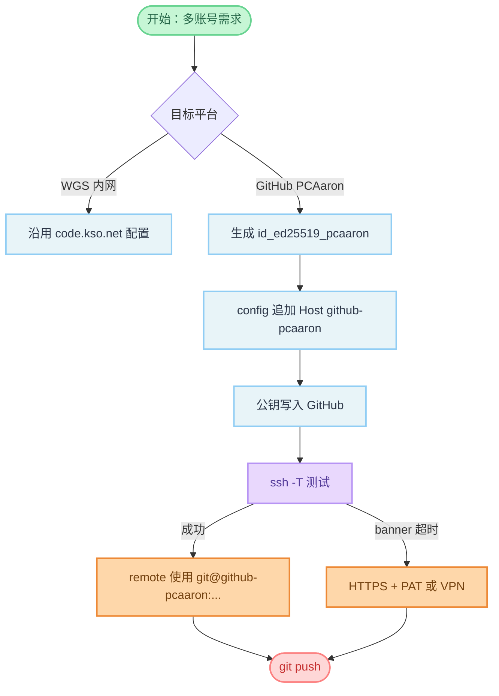

# 多 GitHub 账号与 Git 远程管理

> 适用环境：Windows + Git for Windows + OpenSSH Agent  
> 典型场景：公司内网 Git（WGS）与个人/项目 GitHub 账号并存，且**不改动**已有 SSH 与远程配置。

---

## 1. 目标与原则

| 原则           | 说明                                                                          |
| -------------- | ----------------------------------------------------------------------------- |
| 一账号一密钥   | 每个 GitHub 账号使用独立 SSH 密钥，避免混用导致认证到错误账号                 |
| Host 别名隔离  | 用 `~/.ssh/config` 中的 `Host` 别名选择密钥，而不是共用 `github.com`          |
| 远程名表达意图 | `origin` 可指向自有仓库；模板源可用 `upstream`；勿在未确认前覆盖已有 `origin` |
| 内网优先 HTTPS | 若 SSH 握手被防火墙拦截，优先用 HTTPS + PAT，不影响 WGS 配置                  |

---

## 2. 本机 SSH 配置结构（示例）

全局 Agent（Windows 推荐，便于 passphrase）：

```ssh-config
Host *
  IdentityAgent //./pipe/openssh-ssh-agent
```

**内网 Git（已有，勿改）：** 例如 WGS 使用 `id_ed25519`：

```ssh-config
Host code.kso.net
  HostName code.kso.net
  User git
  IdentityFile ~/.ssh/id_ed25519
  IdentitiesOnly yes
```

**GitHub 项目账号（追加到文件末尾）：** 使用别名 `github-pcaaron`：

```ssh-config
Host github-pcaaron
  HostName github.com
  User git
  IdentityFile ~/.ssh/id_ed25519_pcaaron
  IdentitiesOnly yes
```

说明：

- 克隆/推送 URL 写 `git@github-pcaaron:PCAaron/仓库名.git`，**不要**写 `git@github.com:...`（否则会走默认密钥，可能认证失败或登错账号）。
- `IdentitiesOnly yes` 防止 SSH 尝试其他密钥。

若将来还有「主 GitHub 账号」，可再追加一段（仍不影响 WGS 与 PCAaron）：

```ssh-config
Host github.com
  HostName github.com
  User git
  IdentityFile ~/.ssh/id_ed25519_你的主账号
  IdentitiesOnly yes
```

---

## 3. 为新 GitHub 账号添加 SSH（首次）

### 3.1 生成专用密钥

PowerShell：

```powershell
ssh-keygen -t ed25519 -C "PCAaron的GitHub邮箱" -f "$env:USERPROFILE\.ssh\id_ed25519_pcaaron"
```

建议设置 passphrase，并加入 Agent（可选）：

```powershell
ssh-add "$env:USERPROFILE\.ssh\id_ed25519_pcaaron"
```

### 3.2 公钥登记到 GitHub

1. 复制公钥：`Get-Content "$env:USERPROFILE\.ssh\id_ed25519_pcaaron.pub" | Set-Clipboard`
2. 登录对应 GitHub 账号 → **Settings** → **SSH and GPG keys** → **New SSH key**
3. 粘贴保存

### 3.3 验证

```powershell
ssh -T git@github-pcaaron
```

成功时类似：`Hi PCAaron! You've successfully authenticated...`

---

## 4. Git 远程：保留模板源 + 推送到自有仓库

### 4.1 从模板克隆到当前目录

```powershell
git clone https://github.com/timlrx/tailwind-nextjs-starter-blog.git .
```

此时默认 `origin` 指向模板仓库。

### 4.2 推荐远程布局

| 远程名                | 用途                     | URL 示例                                                     |
| --------------------- | ------------------------ | ------------------------------------------------------------ |
| `upstream`            | 只读：原模板，偶尔拉更新 | `https://github.com/timlrx/tailwind-nextjs-starter-blog.git` |
| `origin` 或 `pcaaron` | 读写：自有 Game Site Kit | SSH：`git@github-pcaaron:PCAaron/Game-site-kit.git`          |
|                       |                          | HTTPS：`https://github.com/PCAaron/Game-site-kit.git`        |

**只新增、不改内网：** 若 `origin` 仍要留给模板，可只添加第二个远程：

```powershell
git remote add pcaaron git@github-pcaaron:PCAaron/Game-site-kit.git
git push -u pcaaron main
```

**以自有仓库为主远程：**

```powershell
git remote rename origin upstream
git remote add origin git@github-pcaaron:PCAaron/Game-site-kit.git
git push -u origin main
```

从模板同步更新：

```powershell
git fetch upstream
git merge upstream/main
```

### 4.3 仅本仓库设置提交者（可选）

若 PCAaron 账号使用不同 `user.name` / `user.email`：

```powershell
git config user.name "PCAaron"
git config user.email "你的PCAaron邮箱@example.com"
```

仅影响当前仓库，不修改全局 Git 配置。

---

## 5. 故障排查

### 5.1 `Unbound variable "PWD"`（Windows 跑 `yarn dev`）

模板脚本使用 Unix 的 `$PWD`，在 Windows 下会失败。本项目 `package.json` 已改为 `%cd%`；临时可用：

```powershell
yarn start
```

### 5.2 SSH：`Connection timed out` / `banner exchange`

**现象：** TCP 能连上，但在 `banner exchange` 阶段超时（公司网、运营商或 GFW 对 GitHub SSH 干扰较常见）。

**诊断：**

```powershell
ssh -vT git@github-pcaaron
```

若看到 `Connection established` 后仍 `banner exchange` 超时，多为网络策略问题，而非密钥错误。

**修复选项（按推荐顺序）：**

| 方案               | 操作                                                                                                            | 说明                                     |
| ------------------ | --------------------------------------------------------------------------------------------------------------- | ---------------------------------------- |
| A. HTTPS + PAT     | `git remote set-url origin https://github.com/PCAaron/Game-site-kit.git`，推送时用 Personal Access Token 作密码 | 内网环境成功率最高                       |
| B. SSH 443         | 将 `HostName` 改为 `ssh.github.com` 并加 `Port 443`                                                             | 部分网络有效；若 443 上 SSH 仍被拦则无效 |
| C. 换网络 / VPN    | 热点或家庭网络再 `git push`                                                                                     | 不改配置                                 |
| D. `gh auth login` | GitHub CLI 浏览器登录 + HTTPS                                                                                   | 与 A 类似                                |

**443 备用 SSH 配置（可试）：**

```ssh-config
Host github-pcaaron
  HostName ssh.github.com
  Port 443
  User git
  IdentityFile ~/.ssh/id_ed25519_pcaaron
  IdentitiesOnly yes
```

**HTTPS 推送要点：**

1. GitHub → Developer settings → Personal access tokens → 生成 token（需 `repo` 权限）
2. `git push` 时用户名填 GitHub 账号，密码填 **PAT**（不是登录密码）
3. Windows Git Credential Manager 可保存凭据

### 5.3 `Could not read from remote repository`

依次检查：

1. 远程 URL 是否用了正确的 Host 别名（SSH）或 HTTPS 地址
2. 仓库是否已在对应账号下创建，且你有 push 权限
3. 公钥是否加在**同一账号**的 GitHub Settings 中
4. 内网是否拦截 SSH（见 5.2）

---

## 6. Game Site Kit 仓库速查

当前推荐认知（以你本机 `git remote -v` 为准）：

- **自有仓库：** [PCAaron/Game-site-kit](https://github.com/PCAaron/Game-site-kit)
- **模板来源：** [timlrx/tailwind-nextjs-starter-blog](https://github.com/timlrx/tailwind-nextjs-starter-blog)
- **SSH 别名：** `github-pcaaron` → 密钥 `~/.ssh/id_ed25519_pcaaron`
- **内网 Git：** 仍走 `code.kso.net` / `ksogit.kingsoft.net` + `id_ed25519`，与 GitHub 配置互不影响

---

## 7. 操作检查清单

**首次配置 PCAaron GitHub（SSH 路径）**

- [ ] 生成 `id_ed25519_pcaaron`
- [ ] 在 `~/.ssh/config` **末尾**追加 `Host github-pcaaron`
- [ ] 公钥添加到 PCAaron GitHub
- [ ] `ssh -T git@github-pcaaron` 通过
- [ ] `git remote add` / `set-url` 使用 `git@github-pcaaron:PCAaron/...`
- [ ] `git push -u <远程名> main` 成功

**若 SSH 在内网失败**

- [ ] 改用 HTTPS 远程 + PAT
- [ ] 或换网络 / VPN 后再试 SSH

---

## 流程图解


