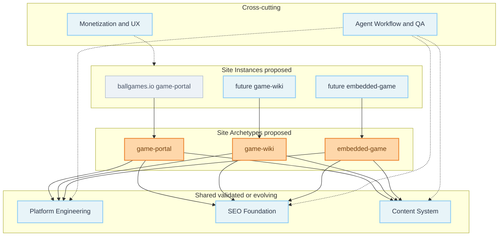

# 系统概览（逻辑架构）

本文描述 Game Site Kit 的**逻辑域**与职责边界，不是实现目录树，也不声明已存在的 API 或模块名。能力状态：

- **validated** — 仓库审计或命令执行有证据（见 [`docs/agent/reports/template-audit.md`](../../docs/agent/reports/template-audit.md)）。
- **proposed** — 章程或 SEO 指南中的目标设计，**尚未实现**。
- **experimental** — 已有局部试验但未达阶段验收。

基线 commit：`723499bf9e590b398ed888cffc834a9c54274d00`（`v2.4.0-9-g723499b`）。

---

## 1. Platform Engineering

**职责：** 工程基座、路由与布局、主题、资源与构建/部署，使站点实例可配置、可构建、可发布。

| 类别 | 说明 |
|---|---|
| **主能力** | Next.js App Router SSG、Tailwind、Yarn 脚本、`EXPORT`/`BASE_PATH` 模式、Windows `INIT_CWD` 包装（**validated**） |
| **依赖** | Node 20（CI/Dev Container）；本机审计曾用 Node 22 |
| **边界外** | 具体游戏业务路由、Wiki 条目 schema、广告 SDK |
| **共享** | 构建链、布局壳、设计 token、实例级 env/配置入口（**proposed**：多实例配置层） |
| **原型专属** | 各 archetype 的路由表与布局组合（**proposed**） |

**validated 现状：** 博客 IA（`/`, `/blog`, `/tags`, `/projects`, `/about`）；**无**站点实例配置层。

---

## 2. SEO Foundation

**职责：** 搜索意图到页面的技术映射、URL/canonical、索引资格、metadata、结构化数据、sitemap/robots、RSS、SEO 验收。

| 类别 | 说明 |
|---|---|
| **主能力** | `app/layout.tsx` metadataBase、`app/seo.tsx`、`sitemap.ts`、`robots.ts`、文章 BlogPosting JSON-LD、RSS postbuild（**validated**） |
| **依赖** | `data/siteMetadata.js` 的 `siteUrl`；contentlayer 生成的路径 |
| **边界外** | 页面策略表内容、关键词研究、运营监控仪表盘 |
| **共享** | metadata/canonical/sitemap **生成机制**（演进中） |
| **原型专属** | 各 archetype 的页面类型、索引规则、JSON-LD 类型选择（**proposed**） |

**validated 缺口（须后续阶段修复，非否认现有代码）：** 模板 `siteUrl` 仍为演示域名；frontmatter `canonicalUrl` 未接入文章 metadata；sitemap 未覆盖游戏/Wiki 路由；无 per-archetype 页面策略表。

---

## 3. Content System

**职责：** 内容加载、文档类型、 frontmatter、MDX 渲染、索引衍生（tag/search/RSS）。

| 类别 | 说明 |
|---|---|
| **主能力** | contentlayer2 + `data/**/*.mdx`、`contentlayer.config.ts`、MDX 插件链、`onSuccess` → `tag-data.json` / `search.json`（**validated**） |
| **依赖** | Platform 构建；SEO 使用生成路径 |
| **边界外** | 外部 CMS、实时多人编辑 |
| **共享** | MDX 管线与渲染组件（在 ADR 0001 约束下保留） |
| **原型专属** | `Blog` 之外的 Game / WikiEntry / GameRuntime 等模型（**proposed**） |

**validated 现状：** 单一 `Blog` + `Authors` 类型；**无**游戏目录或 Wiki 结构化模型。

---

## 4. Site Archetypes

**职责：** 定义 `game-portal`、`game-wiki`、`embedded-game` 的用户旅程、页面类型、内容契约与 SEO 策略。

| Archetype | 主旅程 | 状态 |
|---|---|---|
| `game-portal` | 发现 → 分类 → 详情 → Play | **proposed**（首实例：ballgames.io） |
| `game-wiki` | 导航 → 阅读 → 内链深入 | **proposed** |
| `embedded-game` | 落地 → 站内运行 → 回退 | **proposed** |

**边界外：** 共享 Platform 不应强制三种原型共用同一内容 schema。

**依赖：** Content System 扩展、SEO 页面策略、Platform 路由；embedded 另依赖安全/CSP 决策。

---

## 5. Monetization & UX

**职责：** 广告位边界、性能与移动端体验、分析与评论/Newsletter 的实例级开关、合规检查。

| 类别 | 说明 |
|---|---|
| **validated** | 无广告集成；pliny Analytics/Comments/Newsletter **配置存在**，未配置 env 时通常无有效追踪 |
| **proposed** | Feature flags 强制默认关闭；per-site 变现配置 |
| **共享** | UX 模式（主题、导航、Play 按钮行为约定） |
| **原型专属** | portal 列表页广告 vs wiki 阅读流 vs 游戏运行区干扰度规则 |

AGENTS 默认：广告与分析关闭，除非目标站点明确启用。

---

## 6. Agent Workflow & QA

**职责：** 阶段化任务、审计、验证命令、STATUS/WORKLOG/ADR、差异审查。

| 类别 | 说明 |
|---|---|
| **validated** | `AGENTS.md`、`docs/agent/*`、`yarn lint` / `typecheck` / `build`；**无** `yarn test` |
| **proposed** | 完整 `specs/phases/` 树、SEO 子 Spec、自动化 e2e |
| **依赖** | 各域交付物路径真实存在 |

**边界外：** 替代人工的产品与法务决策（域名、游戏授权、iframe 许可）。

---

## 逻辑关系（概览）

---

## 与 Phase 0 审计的对照

| 逻辑域 | 基线结论（审计 §13） |
|---|---|
| Platform Engineering | 单博客实例；无实例配置层 |
| SEO Foundation | 博客型端点可用；缺策略表与 archetype 规则 |
| Content System | 单一 Blog 文档类型 |
| Site Archetypes | **未实现** |
| Monetization & UX | 无广告；分析/评论配置未强制关闭于代码 |
| Agent Workflow & QA | lint/typecheck/build；`specs/` 曾缺失（Phase 1 补齐核心文件） |

---

## 参考

- [`specs/00-project-charter.md`](../00-project-charter.md)
- [`docs/agent/decisions/0001-template-baseline.md`](../../docs/agent/decisions/0001-template-baseline.md)
- [`docs/game-site-kit-seo-architecture-and-template-iteration-guide.md`](../../docs/game-site-kit-seo-architecture-and-template-iteration-guide.md) §3–§4
